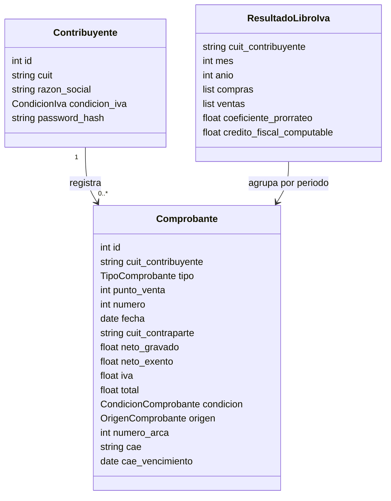
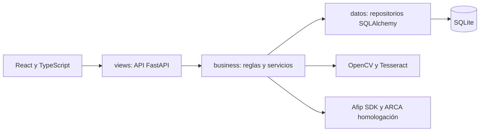

# Libro de IVA Digital

Trabajo Práctico Integrador — Soporte, Grupo 2, 2026.
Estado documentado al **10 de noviembre de 2026**, según el código del repositorio.

## Narrativa y alcance

Aplicación web para registrar compras y ventas, consultar el Libro de IVA mensual y analizar operaciones. La carga puede hacerse manualmente o mediante una imagen: el OCR propone los datos y el usuario los revisa antes de guardarlos. Incluye prorrateo acumulado del crédito fiscal, estadísticas e integración con ARCA en homologación.

El alcance actual es un prototipo académico. No se acredita un despliegue público ni facturación en producción.

## Abstract

Web application for recording purchase and sales invoices, extracting invoice data through OCR, and building monthly VAT ledgers with a cumulative input VAT allocation coefficient. It includes authenticated taxpayer accounts, annual statistics, and invoice issuance and reconciliation through ARCA's testing environment.

## Requerimientos funcionales implementados

| Función | Comportamiento actual |
|---|---|
| Registro y acceso | CUIT, razón social, condición de IVA y contraseña con confirmación. Inicio y cierre de sesión. Admite monotributo y responsable inscripto. |
| Comprobantes | Alta manual de compras y ventas: facturas A/B/C, notas de crédito y débito. |
| OCR | Lectura de imágenes con OpenCV y Tesseract; propone identificación, fecha, contraparte e importes para revisión. |
| Libro de IVA | Consulta por mes y año, compras y ventas, coeficiente acumulado y crédito fiscal computable. |
| Emisión | Ventas A/B/C en homologación, con número ARCA, CAE y vencimiento. |
| Validación de ventas | Compara fecha, neto, IVA, total y CAE; identifica pendientes y comprobantes no encontrados. |
| Conciliación de compras | Identifica coincidencias, diferencias, compras faltantes y sin emisión encontrada dentro del circuito de usuarios del sistema. |
| Estadísticas | Consulta anual y filtro mensual; totales, cantidades, barras comparativas, tabla y acceso al libro de cada período. |
| Interfaz | Rutas protegidas, diseño adaptable y tema claro/oscuro. |

Las estadísticas incluyen IVA en los importes, restan las notas de crédito y las cuentan como comprobantes. La diferencia entre ventas y compras no representa la ganancia.

## Reglas de negocio

1. El CUIT debe tener 11 dígitos sin guiones y ser único. Se valida el formato, sin verificar el dígito fiscal.
2. La contraseña y su confirmación deben coincidir. Se guarda un hash PBKDF2-HMAC-SHA256 con salt aleatorio y 100.000 iteraciones.
3. La clave de duplicados es contribuyente + condición compra/venta + tipo + punto de venta + número. Actualmente no incluye el CUIT de contraparte.
4. Los importes deben ser no negativos. El total debe coincidir con neto gravado + neto exento + IVA, con tolerancia de $0,01.
5. El coeficiente usa ventas gravadas y exentas acumuladas desde enero hasta el mes consultado. Sin ventas exentas, incluso sin ventas, vale 1. Debe estar entre 0 y 1; se redondea a cuatro decimales.
6. El crédito computable es el IVA de compras del mes multiplicado por ese coeficiente, redondeado a dos decimales.
7. Solo se emiten ventas propias, existentes y sin CAE previo, de tipo A/B/C. Las notas no se emiten porque no se registra el comprobante asociado.
8. Para emitir, la aplicación exige una fecha dentro de cinco días respecto de hoy. Facturas C deben tener IVA cero; para A/B con neto gravado positivo se comprueban las tasas que admite el código: 0%, 2,5%, 5%, 10,5%, 21% o 27%.

```text
coeficiente = gravadas_acumuladas / (gravadas_acumuladas + exentas_acumuladas)
credito_computable = IVA_compras_del_mes * coeficiente
```

Ejemplo: ventas gravadas acumuladas de $100.000 y exentas de $25.000 producen un coeficiente de 0,8. Con IVA de compras mensual de $21.000, el crédito computable es $16.800.

## Modelo de dominio



La relación usa `cuit_contribuyente`; el esquema actual no declara una clave foránea. `ResultadoLibroIva` se calcula al consultar y no es una tabla persistida. Los orígenes definidos son manual, OCR y ARCA; las condiciones son compra y venta. Los campos de emisión son opcionales.

## Arquitectura y stack tecnológico



| Capa | Ubicación y tecnologías | Responsabilidad |
|---|---|---|
| Presentación | `front/src`: React 19, TypeScript, Vite 6, Tailwind CSS 4, React Router. `back/views`: FastAPI y Pydantic. | Formularios, navegación, gráficos, contratos de entrada/salida y API JSON. |
| Negocio | `back/business`, Python | Reglas, autenticación, OCR, prorrateo, estadísticas y coordinación con ARCA. |
| Datos | `back/datos`, SQLAlchemy 2 y SQLite | Persistencia, consultas y conversión entre ORM y objetos de dominio. |

SQLite simplifica la ejecución local y SQLAlchemy concentra el acceso a la base. FastAPI expone documentación interactiva de la API. React separa la interfaz del backend. OpenCV prepara imágenes y Tesseract reconoce texto. El cliente ARCA encapsula las llamadas mediante `afip.py`.

El punto de entrada es `back/app.py`: carga `TPI/.env` e inicia Uvicorn en el puerto 8001. Vite redirige `/api` al backend en desarrollo. FastAPI puede servir el frontend compilado en `front/dist`.

## Casos de uso principales

### Registrar y consultar un comprobante

1. El contribuyente inicia sesión y abre Cargar comprobante.
2. Completa el formulario o selecciona una imagen para OCR.
3. Revisa los datos detectados y corrige los campos necesarios.
4. Guarda; negocio verifica duplicados e importes y datos persiste el comprobante.
5. Consulta el Libro de IVA del mes para ver la operación y sus cálculos.

Ante datos inválidos o duplicados, la API devuelve un error y no registra el alta.

### Emitir y validar una venta

1. Desde el libro mensual, solicita emitir una venta.
2. El sistema valida titularidad, tipo, fecha, IVA y ausencia de emisión previa.
3. Solicita autorización en homologación y guarda número ARCA, CAE y vencimiento.
4. En Validar con ARCA, consulta el período y visualiza coincidencias o diferencias.

### Consultar estadísticas

1. Selecciona año y, opcionalmente, mes.
2. El sistema agrupa compras y ventas del CUIT autenticado en doce meses.
3. La pantalla muestra totales, cantidades y comparación mensual, con acceso al libro de cada mes.

## Requerimientos no funcionales

| Categoría | Implementación o verificación pendiente |
|---|---|
| Portabilidad | Interfaz adaptable; compatibilidad entre navegadores pendiente de validación manual. El código usa sintaxis de Python 3.10 o superior; consultar requisitos de instalación. |
| Seguridad | Hash de contraseñas, JWT HS256 de 60 minutos, token en `sessionStorage`, autenticación Bearer y secretos por entorno. Configurar `JWT_SECRET` propio fuera de desarrollo. |
| Mantenibilidad | Separación en `views`, `business` y `datos`; Git y pruebas pytest. El punto de entrada real está en `back/app.py`. |
| Confiabilidad | Validaciones, rollback de transacciones y errores HTTP. Pruebas de negocio, OCR, seguridad, estadísticas y ARCA. |
| Escalabilidad | Sesiones por token; navegación normal e incógnita pueden usar usuarios separados. Sin pruebas de carga documentadas. |
| Rendimiento | Ejecución local con SQLite, sin mediciones de latencia acreditadas. |
| Reutilización | Objetos de dominio y servicios separados de los componentes React. |
| Flexibilidad | Acceso SQL centralizado; otro motor requiere adaptar configuración y verificar compatibilidad. |

## Límites y pendientes

- La integración usa homologación y el CUIT compartido de desarrollo de Afip SDK. No factura en producción para cada contribuyente registrado.
- Las compras recibidas se reconstruyen a partir de ventas de otros usuarios y se consultan individualmente. No se importa el universo de compras de un CUIT desde Mis Comprobantes.
- Las estadísticas restan notas de crédito. El cálculo del libro y del prorrateo suma los importes almacenados sin invertir el signo por tipo; queda pendiente unificar ese tratamiento.
- La API actual no expone exportación del libro, cierre mensual persistido ni edición/eliminación de comprobantes.
- Pendientes de acreditar: despliegue público, pruebas en varios navegadores, revisión completa PEP8/Flake8, capturas de pantallas y datos de carátula de los integrantes.

## Pruebas, bibliografía y código fuente

Consultar [README](README.md) para instalación y comandos, la [guía OCR/ARCA](docs%20prueba/GUIA_PRUEBA_ARCA.md) para el recorrido de prueba y los [criterios generales](checklist_general.md) y [de capas](checklist_capas.md) para la entrega.

Código fuente: [repositorio del Grupo 2](https://github.com/JeroC2004/practica-2026-Grupo2-).

Referencias de las bibliotecas utilizadas: [Python](https://docs.python.org/3/), [FastAPI](https://fastapi.tiangolo.com/), [SQLAlchemy](https://docs.sqlalchemy.org/), [React](https://react.dev/), [Vite](https://vite.dev/), [Tesseract](https://tesseract-ocr.github.io/), [OpenCV](https://docs.opencv.org/), [pytest](https://docs.pytest.org/), [PyJWT](https://pyjwt.readthedocs.io/) y [Afip SDK](https://docs.afipsdk.com/).
